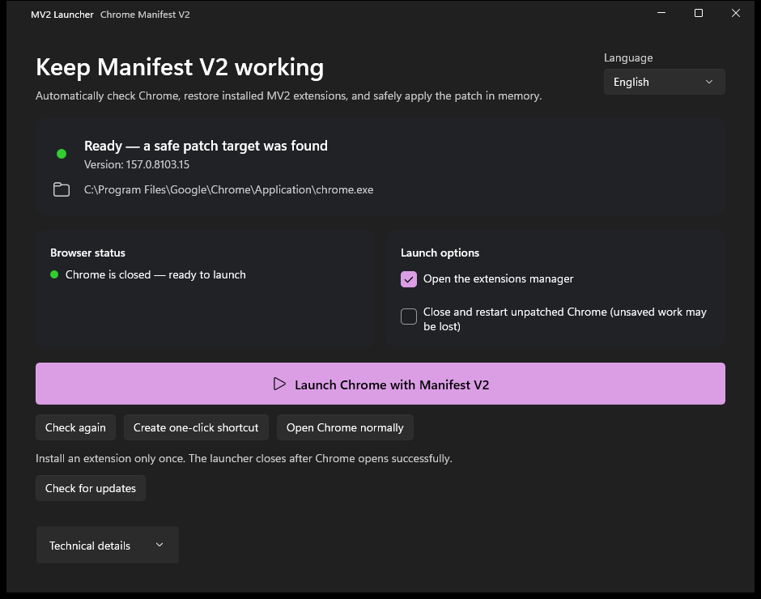
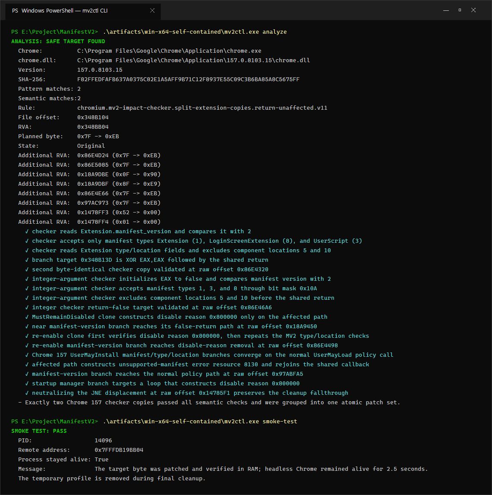

# MV2 RAM Launcher for Chrome

`mv2ctl` finds Chrome's Manifest V2 deprecation gates and applies verified in-memory edits after `chrome.dll` is loaded. It does not modify `chrome.dll` on disk.

If Chrome previously persisted the MV2-only disable reason (`8388608`), `launch` removes only that reason before startup, preserves unrelated disable reasons, and restamps Chrome's protected preferences. It creates a one-time `Secure Preferences.mv2ctl.bak` backup.

Version `3.11.0` adds **automatic local semantic offset discovery and a verified analysis cache**. The native .NET engine derives the error resource ID from Chrome's English language pack, decodes the MV2 predicates and validates a complete patch family. It does not download offset lists or require REA/Python on the user's computer. Verified legacy rules remain a fallback for older supported layouts. Unknown control flow still fails closed; this is not a promise of support for every future Chrome release.

### Automatic discovery and cache

- First analysis of a changed DLL runs the local decoder/validator. Later invocations reuse the plan only after a full streaming DLL SHA-256 check, resource-pack identity check and verification of every planned original byte.
- Cache files are stored in `%LOCALAPPDATA%\ChromeMv2Launcher\analysis-cache`, protected for the current Windows user with DPAPI and published atomically. Damaged, incompatible or inaccessible caches trigger normal analysis; only successful original-image plans are saved.
- A changed DLL, English resource pack, or analysis engine invalidates the cache. File timestamps alone are never trusted. The DLL is re-hashed and pinned before launch so stale GUI results cannot authorize a replacement image.
- The GUI distinguishes automatic discovery from a verified cache hit in Vietnamese, English and Simplified Chinese. CLI JSON exposes `CacheHit` and `AnalysisMilliseconds`; use `mv2ctl analyze --no-cache --json` to force discovery without reading or writing the cache.
- The offset cache is separate from GitHub application-update checking. A cache hit avoids code scanning, not the short online release check.

See [the bounded semantic engine and test evidence](docs/automatic-offsets.md).

Vietnamese instructions: [README.vi.md](README.vi.md)

## Packaged executable

The recommended self-contained WinUI 3 GUI is:

```powershell
.\artifacts\win-x64-gui\ChromeMv2Launcher.exe
```

It analyzes Chrome on startup, monitors whether Chrome is running, repairs persisted MV2 profile state when necessary, and exposes the verified RAM launch as one primary button. GitHub Releases use a normal ZIP containing the self-contained app rather than a self-extracting executable, reducing opaque packaging and making every runtime file inspectable.

Use **Create one-click shortcut** to add a Desktop shortcut that analyzes and launches Chrome with the RAM patch in one action. The app checks GitHub Releases at startup. When a newer version is published, **Install update** downloads the GUI ZIP, checks its SHA-256 digest, extracts it into a per-user versioned directory, updates the Desktop shortcut, and opens the new app. **Open Chrome normally** remains available if the current Chrome build has no verified patch.

After a successful patched or normal launch, the GUI exits immediately while Chrome keeps running. This applies to both the launch button and the Desktop shortcut. If analysis or launch fails, the GUI stays open to display the error. Advanced users can pass Chrome arguments after `--`, for example `ChromeMv2Launcher.exe --auto-launch -- --user-data-dir=E:\Chrome-MV2-Profile`.

Every GUI executable startup first attempts a GitHub update check, bounded to three seconds, including shortcut and windowless-reuse invocations. If a newer release is found, the GUI stays open with **Install update** instead of automatically opening another browser window. Installation still requires a click; it is never silent. Offline, rate-limited, malformed, or timed-out update checks do not block the usual Chrome launch/reuse path, and their error is displayed if the GUI opens.

When Chrome is already running and no update was found, both the one-click shortcut and the executable itself verify every RAM patch byte in the browser root process. Only a fully verified session with the same user-data directory is reused. The check analyzes that process's loaded `chrome.dll`, including an older version still running after an on-disk Chrome update. Unpatched, partially patched, inaccessible, or unsupported sessions are not reused or modified. URLs and profile arguments are forwarded, with or without the `--` separator. Use `ChromeMv2Launcher.exe --show-ui` to open settings and update controls explicitly.

**Close and restart unpatched Chrome** is off by default. Enable it in the GUI (use `--show-ui` if necessary); the preference is saved per user and also applies to the one-click shortcut. Each restart requires confirmation. The launcher first verifies the complete original-byte patch set, executable, Windows user/session, and user-data directory; partial, unsupported, inaccessible, or unrelated sessions are not closed. Normal window closure is tried first. Background Chrome or a cancelled unload prompt requires a separate **Force close** confirmation, with **Cancel** as the default. Unsaved work may be lost; cancelling either dialog does not force termination. All windows/profiles sharing that browser session are affected. The consent is bound to the process ID and creation time, and the current on-disk Chrome is analyzed before closing and again before relaunching. The final launch guard still requires all Chrome processes to be gone.

The GUI supports Vietnamese, English, and Simplified Chinese. It selects the Windows UI language on first run and persists the user's choice under `%LOCALAPPDATA%\ChromeMv2Launcher`.



### CLI

The self-contained Windows x64 build is at `artifacts\win-x64-self-contained\mv2ctl.exe`. It does not require a separately installed .NET runtime.



```powershell
.\artifacts\win-x64-self-contained\mv2ctl.exe analyze
.\artifacts\win-x64-self-contained\mv2ctl.exe launch
```

## Safety properties

- Scans only the executable `.text` PE section.
- Does not use an expected file offset or RVA.
- Enumerates every byte-pattern candidate and applies structural checks.
- `mv2ctl probe` lists possible MV2 checker/clone sites using a broader read-only heuristic. Probe results never authorize a patch.
- Requires the exact rule-specific set of semantic matches; missing or extra candidates abort.
- Chrome 152 rule v5, Chrome 153 rule v6, Chrome 154 rule v7, and Chrome 155 rule v8 locate both split `Extension&` checker copies, the integer-argument checker, and the compiler-generated install/disable/re-enable clones.
- Rules v8/v9/v10/v11 verify the normal policy call, the relocated unsupported-manifest error path, and their shared callback. They require localized error resource 8129 (Chrome 155), 8121 (Chrome 156 early stable), 8122 (Chrome 156.0.8078.48), or 8130 (Chrome 157.0.8103.15 / 157.0.8103.39), respectively. No arbitrary resource ID is accepted.
- Locates and neutralizes the startup branch whose verified target constructs disable reason `0x800000`.
- Verifies every original byte in the remote process before writing any target.
- Reads every byte back after writing and flushes the instruction cache.
- Never writes to `chrome.dll` on disk.
- New patched launches still require Chrome to be fully closed. The GUI may open another window only in an existing browser session whose complete RAM patch set has been verified; it never patches that session during the check.

## Build and test

```powershell
dotnet build .\ManifestV2.slnx -c Release
dotnet test .\ManifestV2.slnx -c Release
dotnet run --project .\src\Mv2Enabler -c Release -- analyze
dotnet run --project .\src\Mv2Enabler -c Release -- smoke-test
dotnet run --project .\src\Mv2Enabler -c Release -- functional-ui-test --extension .\test-extension
```

The patch engine lives in `src\Mv2Enabler.Core`; both the CLI and WinUI 3 app reference the same implementation.

The automated smoke test creates a uniquely named profile below `%TEMP%\mv2ctl-smoke`, launches headless Chrome, applies and verifies the RAM patch, confirms Chrome remains alive, stops only the process tree it created, and removes that temporary profile.

The functional UI test uses Chrome's normal **Load unpacked** workflow, selects `test-extension`, and requires a DevTools target whose `chrome-extension://` host exactly matches the ID derived from the test manifest's fixed public key. It then closes Chrome, launches the same temporary profile again through the RAM patcher, and requires the persistent MV2 background page to return. Its profile is uniquely named and removed afterward. The test briefly opens a Chrome window and restores the clipboard text it temporarily uses for the native folder picker.

After packaging, run `.\scripts\test-gui-launch.ps1` to verify automatic shortcut launch, manual launch, normal Chrome launch, windowless reuse with URL forwarding, explicit GUI access, and rejection of unpatched or mismatched-profile sessions. It uses temporary profiles and checks that the launcher exits while Chrome's DevTools endpoint remains available.

The GUI test also covers restart opt-in, graceful confirmation/cancellation, background force-close confirmation/cancellation, and verified patched reuse after restart. It backs up and restores the restart preference. `RestartSessionIntegrationTests` uses owned temporary headless sessions to test refusal of wrong-profile, partially patched, stale-consent, and already-patched browsers. Close your own Chrome before running integration tests; they never terminate a pre-existing browser as test setup.

For startup-update UI coverage, pass `-UpdateFixturePath <absolute-path-to-test-launcher>` to the GUI test script. Use a separately published test launcher whose assembly version is older than the latest public release. The test requires live GitHub availability, verifies that Install update is shown before automatic launch and before patched-session reuse, and never installs the offered release.

## Chrome updates and troubleshooting (#14)

The launcher does not disable Google Updater services, scheduled tasks, or Chrome update policies. It cannot guarantee that a future Chrome build remains patchable before that build is installed. Google Updater only honors administrative update policies on managed devices, such as domain-joined or Chrome Enterprise Core-enrolled Windows machines. A generic local toggle would not reliably enforce the request on personal/ReviOS machines. See [Google's update-management documentation](https://support.google.com/chrome/a/answer/6350036?hl=en) and the [Chromium Updater specification](https://chromium.googlesource.com/chromium/src/+/HEAD/docs/updater/functional_spec.md).

For **No safe target**, open the latest launcher with `--show-ui`, check for a launcher update, and retain the full Chrome version and technical diagnostics. Signatures are analyzed fresh each run; resetting launcher preferences cannot add support for a new Chrome layout.

To reset only launcher preferences, close the launcher, then rename or remove `language.txt` and `restart-unpatched.txt` under `%LOCALAPPDATA%\ChromeMv2Launcher`. Do not delete `versions` if running an app installed there, and do not remove Chrome's `User Data` or `Secure Preferences`. This release does not establish compatibility with every ReviOS/AME-modified Windows installation; OS-specific failures need their actual diagnostics.

## Launch Chrome

Close every Chrome window and background process, then run:

```powershell
dotnet run --project .\src\Mv2Enabler -c Release -- launch
```

Chrome arguments can be passed after `--`:

```powershell
dotnet run --project .\src\Mv2Enabler -c Release -- launch -- --user-data-dir=E:\Chrome-MV2-Profile
```

Every new browser session must start through `mv2ctl`; the in-memory change disappears when Chrome exits. An MV2 extension only needs to be loaded once: later patched launches preserve the installed entry and prevent Chrome from persisting the unsupported-manifest disable reason again.

## Functional MV2 check

1. Launch Chrome through `mv2ctl`.
2. Open `chrome://extensions` and enable Developer mode.
3. Choose **Load unpacked** and select the repository's `test-extension` directory.
4. Confirm **MV2 Gate Smoke Test** remains enabled and its toolbar badge reads `MV2`.
5. Open `https://example.com` and run this in DevTools:

   ```js
   document.documentElement.dataset.mv2GateSmokeTest
   ```

   The result should be `"running"`.

The test extension exercises a persistent MV2 background page, `browser_action`, a blocking `webRequest` listener, storage, and a content script.

## Commands

```text
mv2ctl analyze [--chrome PATH] [--dll PATH] [--json]
mv2ctl probe [--chrome PATH] [--dll PATH] [--json]
mv2ctl launch [--chrome PATH] [--timeout SECONDS] [--json] [-- CHROME_ARGS]
mv2ctl smoke-test [--chrome PATH] [--timeout SECONDS] [--json]
mv2ctl functional-ui-test --extension PATH [--chrome PATH] [--timeout SECONDS] [--json]
```

The launcher never modifies Google-signed binaries. Profile recovery is deliberately narrow: it removes only the MV2 disable bit, preserves other disable reasons, discovers the current preference MAC seed from `resources.pak` by validating existing MACs, and updates Chrome's protected preference hashes.

## Star History

<a href="https://www.star-history.com/?repos=onlytrisdev%2Fchrome-enable-mv2&type=date&legend=top-left">
 <picture>
   <source media="(prefers-color-scheme: dark)" srcset="https://api.star-history.com/chart?repos=onlytrisdev/chrome-enable-mv2&type=date&theme=dark&legend=top-left" />
   <source media="(prefers-color-scheme: light)" srcset="https://api.star-history.com/chart?repos=onlytrisdev/chrome-enable-mv2&type=date&legend=top-left" />
   
 </picture>
</a>
