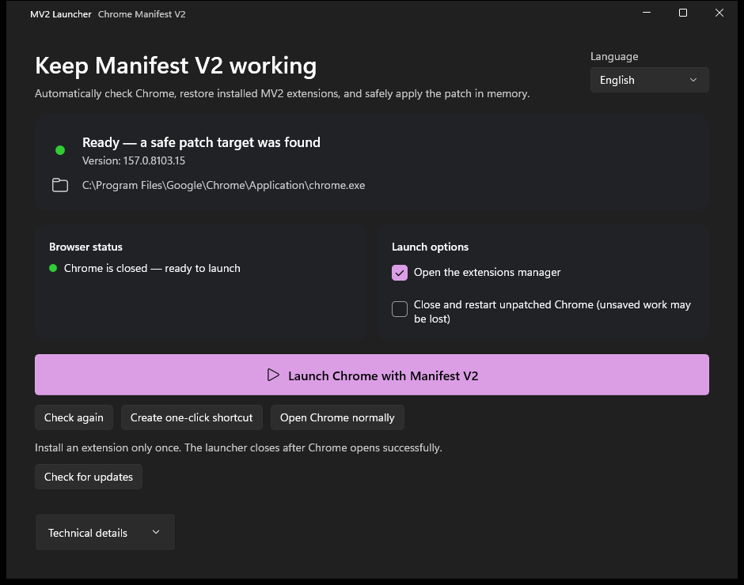
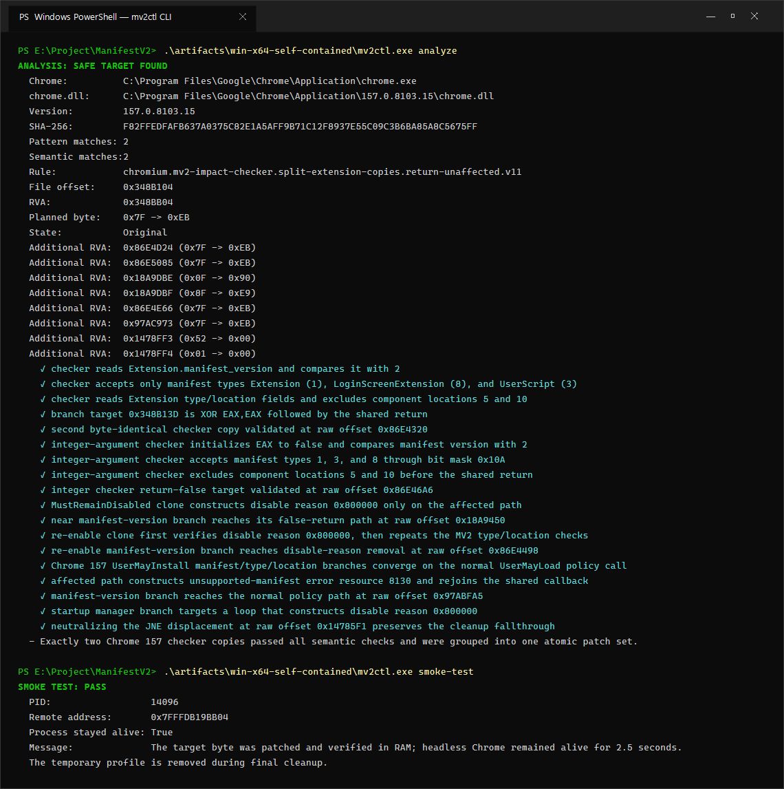

# MV2 RAM Launcher cho Google Chrome

`mv2ctl` mở lại Manifest V2 bằng cách vá các gate đã được xác minh trong RAM của tiến trình Chrome. Công cụ không sửa `chrome.dll` trên đĩa.

Khi Chrome từng lưu lý do vô hiệu hóa MV2 (`8388608`) trong profile, lệnh `launch` sẽ tự gỡ đúng lý do đó trước khi mở trình duyệt, giữ nguyên mọi lý do vô hiệu hóa khác, rồi ký lại `Secure Preferences` bằng cơ chế MAC tương thích với Chrome. Một bản sao lưu một lần được tạo tại `Secure Preferences.mv2ctl.bak`.

Phiên bản `3.11.0` bổ sung **tự tìm offset tại máy và cache kết quả đã xác minh**. Engine .NET đọc ID thông báo lỗi từ file ngôn ngữ tiếng Anh của Chrome, giải mã lệnh và kiểm tra đủ bộ gate MV2. User không cần REA/Python hoặc tải danh sách offset. Các rule cũ vẫn là phương án dự phòng cho layout đã hỗ trợ; luồng lệnh chưa hiểu sẽ bị từ chối, không hứa mọi Chrome tương lai đều tương thích.

### Tự tìm offset và cache

- DLL mới được quét bằng bộ giải mã/kiểm chứng cục bộ. Những lần mở sau chỉ dùng cache nếu SHA-256 toàn bộ DLL, file ngôn ngữ và các byte gốc cần patch đều khớp.
- Cache ở `%LOCALAPPDATA%\ChromeMv2Launcher\analysis-cache`, được Windows DPAPI bảo vệ theo user và ghi thay thế nguyên tử. Cache hỏng, không tương thích hoặc không truy cập được sẽ được bỏ qua để phân tích lại; không cache kết quả thất bại/file đã sửa trên đĩa.
- DLL, file ngôn ngữ hoặc engine thay đổi sẽ phân tích lại. Không chỉ dựa vào kích thước/thời gian file. Ngay trước launch, DLL được kiểm tra hash và giữ handle đọc để từ chối kết quả GUI đã cũ.
- GUI Việt/Anh/Trung hiển thị đang dùng cache hay vừa tự tìm offset. CLI JSON có `CacheHit`, `AnalysisMilliseconds`; lệnh `mv2ctl analyze --no-cache --json` buộc tìm lại mà không đọc/ghi cache.
- Cache offset độc lập với kiểm tra cập nhật ứng dụng trên GitHub. Cache giúp bỏ qua quét mã máy, không bỏ qua bước kiểm tra release ngắn lúc mở app.

Xem [giới hạn engine và bằng chứng kiểm thử](docs/automatic-offsets.md).

## GUI WinUI 3 (khuyên dùng)

Chạy trực tiếp file self-contained:

```powershell
.\artifacts\win-x64-gui\ChromeMv2Launcher.exe
```

Ứng dụng tự phân tích Chrome khi mở. Khi trạng thái chuyển sang **Sẵn sàng**, đóng mọi cửa sổ Chrome và bấm **Mở Chrome với Manifest V2**. Nút launch tự khóa khi Chrome đang chạy và tự bật lại sau khi Chrome đóng.

Nút **Tạo lối tắt một chạm** tạo shortcut Desktop tự phân tích rồi mở Chrome với patch RAM. Ứng dụng tự kiểm tra GitHub Release khi mở; nếu có phiên bản mới, nút **Cài bản mới** sẽ tải ZIP GUI, xác minh SHA-256, giải nén vào thư mục phiên bản riêng trong `%LOCALAPPDATA%\ChromeMv2Launcher\versions`, cập nhật shortcut rồi mở ứng dụng mới. Khi Chrome chưa được hỗ trợ, có thể bấm **Mở Chrome bình thường**.

GUI tự đóng ngay khi mở Chrome thành công, dù dùng nút launch, shortcut hay mở Chrome bình thường. Chrome tiếp tục chạy độc lập. Nếu phân tích hoặc launch gặp lỗi, GUI vẫn mở để hiển thị thông báo. Có thể truyền tham số Chrome sau `--`, ví dụ `ChromeMv2Launcher.exe --auto-launch -- --user-data-dir=E:\Chrome-MV2-Profile`.

Mỗi lần chạy EXE GUI đều thử kiểm tra bản mới trên GitHub, tối đa ba giây, kể cả shortcut và luồng mở thẳng Chrome. Có bản mới thì giữ GUI với nút **Cài bản mới**, không tự mở Chrome. Cài đặt vẫn cần người dùng bấm, không tự cài ngầm. Nếu mất mạng, hết quota API hoặc kiểm tra lỗi/timeout, luồng mở Chrome vẫn tiếp tục; lỗi cập nhật được hiển thị khi GUI mở.

Khi Chrome đã mở và không tìm thấy bản launcher mới, cả shortcut lẫn EXE đều kiểm tra toàn bộ byte patch trong tiến trình browser gốc. Chỉ phiên đã vá đầy đủ và cùng thư mục dữ liệu mới được dùng lại. Công cụ phân tích đúng `chrome.dll` đang nạp; không dùng lại hay sửa phiên chưa vá, vá thiếu, không đọc được hoặc không hỗ trợ. URL và tham số profile được chuyển tiếp dù có hoặc không có `--`. Dùng `ChromeMv2Launcher.exe --show-ui` để chủ động mở cài đặt/cập nhật.

GUI hỗ trợ `Tiếng Việt`, `English` và `简体中文`. Lần chạy đầu ứng dụng tự chọn theo ngôn ngữ Windows, sau đó ghi nhớ lựa chọn tại `%LOCALAPPDATA%\ChromeMv2Launcher\language.txt`.

Tùy chọn **Đóng và mở lại Chrome chưa vá** mặc định tắt. Bật trong GUI (`--show-ui` nếu Chrome đã vá đang chạy); ứng dụng ghi nhớ lựa chọn cho cả shortcut. Mỗi lần restart đều hỏi xác nhận, mặc định chọn Hủy. Công cụ chỉ đóng phiên đã xác minh đầy đủ byte gốc, đúng file Chrome, người dùng/phiên Windows và thư mục dữ liệu; không đóng phiên vá thiếu, không đọc được, không hỗ trợ hoặc không liên quan. Trước hết thử đóng cửa sổ bình thường. Chrome chạy nền hoặc chưa chịu thoát cần xác nhận **Buộc đóng** riêng, vì nội dung chưa lưu có thể mất. Hủy không buộc đóng tiến trình. Mọi cửa sổ/profile cùng một phiên browser sẽ bị ảnh hưởng. Xác nhận gắn với PID và thời điểm tạo tiến trình; Chrome trên đĩa được phân tích trước khi đóng và trước khi mở lại. Luồng launch cuối vẫn yêu cầu không còn tiến trình Chrome.

Bản GitHub Release được đóng gói dạng ZIP self-contained. Sau khi giải nén, chạy `ChromeMv2Launcher.exe`; không cần cài .NET hoặc Windows App Runtime riêng.



## CLI

Đóng hoàn toàn Chrome, kể cả tiến trình chạy nền, sau đó chạy:

```powershell
.\artifacts\win-x64-self-contained\mv2ctl.exe analyze
.\artifacts\win-x64-self-contained\mv2ctl.exe launch
```

Chrome phải được mở qua lệnh `launch` ở mỗi phiên mới vì bản vá RAM biến mất khi trình duyệt thoát. Extension MV2 chỉ cần nạp một lần; các lần sau `launch` sẽ giữ extension đã cài và ngăn Chrome thêm lại lý do `unsupported manifest version`.



CLI vẫn yêu cầu đóng Chrome trước khi khởi tạo phiên vá mới. GUI có thể mở thêm cửa sổ trong phiên đang chạy nếu xác minh được toàn bộ patch RAM và đúng thư mục dữ liệu; phiên chưa xác minh sẽ bị từ chối. Nếu phiên bản Chrome mới không khớp duy nhất với toàn bộ semantic signature, công cụ cũng dừng an toàn và không ghi gì.

## Kiểm thử

### Chrome update và reset cài đặt (#14)

Công cụ không tắt dịch vụ/task Google Updater hay can thiệp policy cập nhật Chrome. Policy quản trị chỉ được Google Updater tôn trọng trên thiết bị được quản lý; một toggle trên Windows cá nhân/ReviOS không bảo đảm chặn update. Không thể hứa phiên bản Chrome tương lai sẽ patch được trước khi nó được cài. Xem [tài liệu Google](https://support.google.com/chrome/a/answer/6350036?hl=en).

Nếu báo không tìm được target an toàn, mở launcher mới nhất bằng `--show-ui`, kiểm tra bản launcher mới và giữ thông tin phiên bản Chrome cùng chi tiết kỹ thuật. Reset cài đặt không thể bổ sung signature cho Chrome mới.

Để reset riêng launcher: đóng launcher, đổi tên hoặc xóa `language.txt` và `restart-unpatched.txt` trong `%LOCALAPPDATA%\ChromeMv2Launcher`. Không xóa thư mục `versions` khi chạy EXE nằm trong đó; không xóa profile `User Data` hay `Secure Preferences` của Chrome. Chưa xác nhận khả năng tương thích với mọi bản Windows đã sửa bằng ReviOS/AME.

```powershell
dotnet test .\ManifestV2.slnx -c Release
.\artifacts\win-x64-self-contained\mv2ctl.exe smoke-test
.\artifacts\win-x64-self-contained\mv2ctl.exe functional-ui-test --extension .\test-extension
```

Build trọn bộ artifact phát hành:

```powershell
.\scripts\build-release.ps1
```

`functional-ui-test` tạo profile tạm, dùng luồng **Load unpacked** thật của `chrome://extensions`, chọn extension MV2 mẫu và yêu cầu đúng extension ID xuất hiện ở trạng thái enabled với persistent background page đang chạy. Sau đó test đóng Chrome, mở lại đúng profile qua RAM patcher và xác nhận background page MV2 tự chạy trở lại. Test tự đóng cây tiến trình, xóa profile tạm và khôi phục nội dung clipboard.

Sau khi build gói phát hành, chạy `.\scripts\test-gui-launch.ps1` để kiểm tra shortcut, nút launch, mở Chrome bình thường, dùng lại phiên đã vá mà không hiện GUI, chuyển tiếp URL, mở GUI bằng `--show-ui`, và từ chối phiên chưa vá/khác thư mục dữ liệu. Test dùng profile tạm và xác minh Chrome vẫn chạy sau khi launcher thoát.

## Nạp extension MV2

1. Mở Chrome bằng `mv2ctl.exe launch`.
2. Truy cập `chrome://extensions`.
3. Bật Developer mode.
4. Chọn **Load unpacked** và chọn thư mục extension MV2.

Để thử extension mẫu, chọn thư mục `E:\Project\ManifestV2\test-extension`.

## Lưu ý

- Chỉ hỗ trợ Google Chrome x64 trên Windows.
- Bản build được kiểm thử trên Google Chrome `155.0.8059.40` và Chrome for Testing `156.0.8078.12`; rule Chrome 151 đến 154 vẫn được giữ lại.
- Công cụ có thể tiếp tục chạy sau update nếu semantic signatures vẫn khớp duy nhất; nếu không, analyzer sẽ fail-closed và cần bổ sung rule mới.
- `mv2ctl probe` dò các vị trí có khả năng liên quan bằng heuristic rộng hơn, chỉ dùng để chẩn đoán; không tự patch từ kết quả probe.
- Seed MAC của profile được tự tìm trong `resources.pak` bằng cách đối chiếu các MAC hiện có; không hard-code seed hoặc offset theo phiên bản.
- Chỉ entry extension có lý do MV2 mới được sửa. Các lý do disable khác được giữ nguyên.
- `mv2ctl.exe` chưa được ký code-signing nên Windows SmartScreen có thể cảnh báo đối với file tự build.
